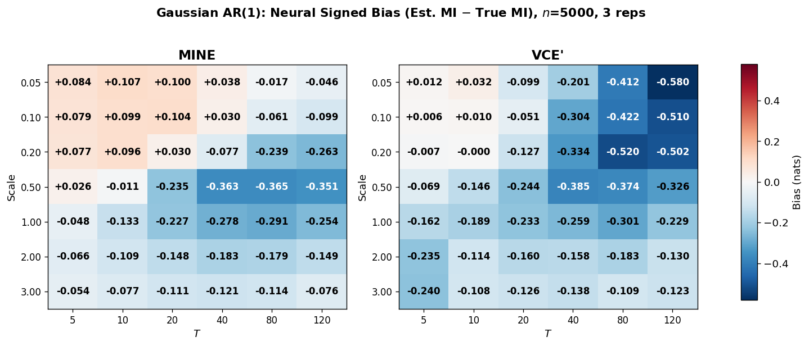

# Machine Learning Methods for Information Transfer Quantification

**Chedy Smaoui · University of St Andrews · Final-year mathematics dissertation, 2026**  
Supervised by Dr Giorgos Minas.

[**Read the dissertation (PDF)**](Machine-Learning-Methods-for-Information-Transfer-Quantification.pdf) · [**Explore the code and results**](code.ipynb)

This project compares machine learning methods for estimating mutual information: how much observing a response reveals about the stimulus that produced it. Motivated by cell signalling, I investigate how estimation accuracy changes with response dimensionality, separation between class means, and the distribution of the noise.

I implemented four estimation approaches and designed a synthetic time-series benchmark with numerically accurate reference values, allowing each method's estimation error to be measured directly.

## Methods

| Approach | Implementation |
| --- | --- |
| Statistical Learning Estimation of Mutual Information (SLEMI) | Uses predicted class probabilities to estimate mutual information. |
| Decoding-based estimation | Computes mutual information from a confusion matrix of held-out class predictions. |
| Mutual Information Neural Estimation (MINE) | Trains a neural network using a variational mutual information objective. |
| Vector Copula Estimation (VCE′ in the notebook) | Learns marginal transformations through flow matching, computes vector ranks, and applies MINE in rank space. |

Both classifier-based approaches are paired with quadratic discriminant analysis (QDA), support vector machines and random forests, giving six classifier configurations alongside the two neural estimators. Classifier predictions are obtained using stratified 5-fold cross-validation.

## Experimental design

The benchmark uses eight stimulus classes with distinct AR(1) dynamics, under Gaussian and Student-t (ν = 3) innovations matched for variance. Each dataset contains 5,000 trajectories.

A grid of seven mean-separation scales and six trajectory lengths, from 5 to 120 time steps, is evaluated for both noise families, with three repetitions per setting. Reference mutual information is estimated by Monte Carlo using 200,000 samples and the known class-conditional densities.

Sample size is held fixed. Class mean separation and response dimensionality are varied independently; close class means do not necessarily imply low mutual information, because classes also differ in their persistence and noise levels.

## Main findings

No single estimator was best across all tested settings. MINE was the most robust overall, particularly with weak separation between class means and high response dimensionality. Probability-based QDA deteriorated in these settings even on Gaussian data, with larger errors under Student-t innovations; its decoding-based counterpart was substantially more stable. VCE often achieved smaller absolute bias than MINE in low-information settings with short trajectories, but was less consistent elsewhere.



*Example from the saved notebook results: signed error in nats, averaged over three repetitions. Columns show trajectory length and rows show the class mean-separation scale. Values closer to zero indicate more accurate estimates.*

## Running the notebook

The notebook includes saved figures for browsing directly on GitHub. To run the experiments, install the dependencies in a Python environment and open JupyterLab:

```bash
python -m pip install numpy scipy scikit-learn matplotlib torch torchdiffeq joblib jupyterlab
python -m jupyterlab code.ipynb
```

Run the cells in order from a fresh kernel. The complete experiment grid is computationally demanding. For an initial smaller run, change the experimental parameters before executing the grid:

```python
T_values = [5, 10]
mu_scales = [0.1, 1.0]
n_repeats = 1
```

The implementations use Python, NumPy, SciPy, scikit-learn and PyTorch, with torchdiffeq for ODE integration, joblib for parallel repetitions, and Matplotlib for visualisation. The dissertation contains the mathematical derivations, full experimental discussion and references.
